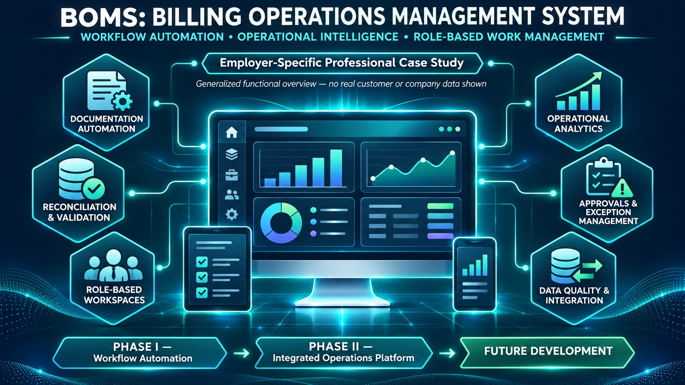

# Billing Operations Management System (BOMS)

**Enterprise billing workflows · Business systems analysis · AI-assisted application development · Operational analytics**

> **Portfolio case study — employer-specific work.** Both initiatives documented here were undertaken in connection with employment at Infratech Corporation. This repository does **not** contain the employer's application, source code, database schemas, internal workflows, or customer information. This material is prepared for disclosure review and should be published only if authorized under applicable policies and agreements.

## Overview

BOMS documents two related stages of employer-specific billing operations improvement.

**Phase I** focused on structured workflow automation, administrative coordination, and operational reporting.

**Phase II** expands these objectives into a more integrated approach to billing operations, including role-oriented workspaces, automated validation, reconciliation, task management, and operational analytics.

Both initiatives were undertaken during employment with Infratech Corporation. The underlying projects and associated intellectual property remain the property of Infratech Corporation.

| Category | Phase I | Phase II |
|---|---|---|
| Primary Focus | Workflow automation | Integrated billing operations |
| Business Objective | Reduce repetitive administrative processing | Consolidate workflows and improve operational visibility |
| Functional Scope | Work coordination, automation, reporting | Role-oriented workspaces, reconciliation, validation, and analytics |
| Development Approach | Business process analysis and workflow design | Requirements engineering, AI-assisted development, and iterative testing |
| Project Status | Earlier initiative | Active limited-user pilot |
| Project Ownership | Infratech Corporation | Infratech Corporation |

## Business context

Billing operations often depend on multiple applications, manually assembled reports, repeated data entry, and human follow-up across roles. These fragmented processes complicate prioritization, reconciliation, and consistent validation. The initiatives explore ways to improve operational visibility and reduce repetitive manual work.

## Phase I — Workflow automation

Phase I focused on structuring billing-related work and automating administrative coordination. Its public-safe description covers workflow intake, assignment, processing visibility, exception awareness, and reporting.

See [Phase I overview](architecture/overview-and-logic-model.md) and [generalized automation pattern](architecture/automation-architecture.md).

## Phase II — Billing operations consolidation and intelligence
### Development Responsibilities

My responsibilities include defining functional requirements, directing AI-assisted application development, making design decisions, troubleshooting generated functionality, testing expected behavior, and refining the application based on operational needs.

### Current Status

Phase II is undergoing limited-user operational evaluation.

Demonstrated capabilities include automated documentation preparation, record reconciliation, identification of items requiring further review, and operational reporting.

Future development and broader organizational use remain subject to internal evaluation.

Specific implementation technologies, infrastructure arrangements, and proprietary integration details are intentionally excluded.

See [Phase II case study](phase-ii/overview.md), [generalized validation approach](phase-ii/validation-and-evaluation.md), and [reporting overview](analytics/reporting-dashboard.md).

## Outcomes and evidence

The pilot has demonstrated working automation and validation capabilities with a limited group of employees. Reduced manual processing has been observed, but comparative timing, error-rate, and financial-impact figures have **not** been independently documented in this public portfolio. No numeric productivity or compliance claims are asserted here.

## Documentation map

- [Phase I architecture overview](architecture/overview-and-logic-model.md)
- [Phase I automation pattern](architecture/automation-architecture.md)
- [Phase I conceptual data flow](architecture/data-flow.md)
- [Phase I generalized workflow](workflows/billing-workflow.md)
- [Phase II functional case study](phase-ii/overview.md)
- [Phase II quality and evaluation approach](phase-ii/validation-and-evaluation.md)
- [Operational reporting](analytics/reporting-dashboard.md)
- [Security and governance principles](governance/governance-and-hardening.md)
- [Public disclosure notice](DISCLOSURE.md)
- [Project website](https://awindsor7912.github.io/billing-operations-management-system/)

> **Employer-Specific Professional Case Study**
>
> Both phases of the Billing Operations Management System document initiatives undertaken during my employment with Infratech Corporation.
>
> The projects, underlying applications, and associated intellectual property remain the property of Infratech Corporation.
>
> This repository is independently maintained as a professional portfolio demonstrating my contributions, technical competencies, and generalized systems design concepts.
>
> Proprietary source code, internal architecture, confidential business information, customer records, and employer-specific implementation details are intentionally excluded.
>
> See [Project Attribution, Intellectual Property & Confidentiality](DISCLOSURE.md) for additional information.
